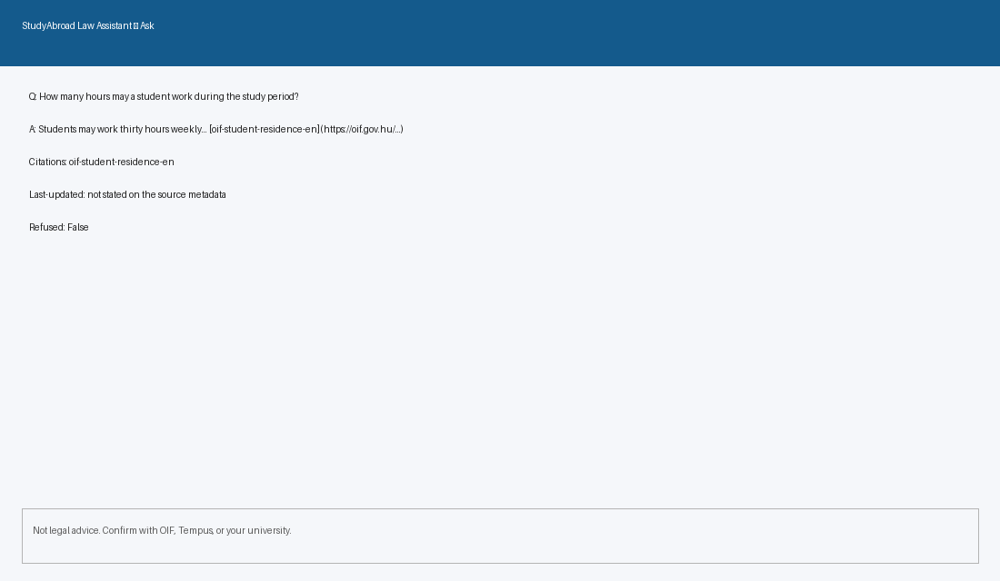
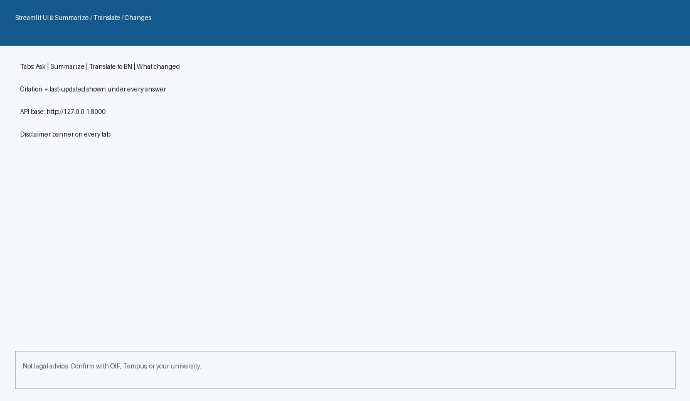
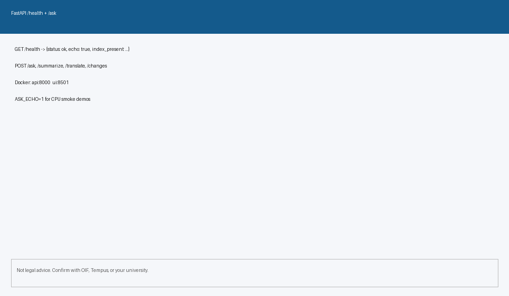
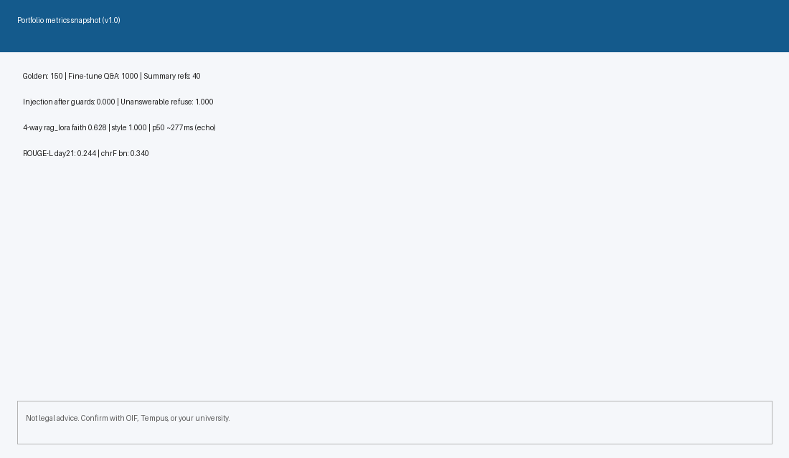
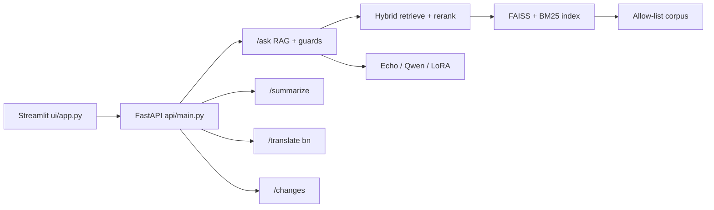

# StudyAbroad Law Assistant (v1.0)

Plain-language answers about **studying in Hungary**, always with a citation to an official allow-list page. **Not legal advice.** Read [DISCLAIMER.md](DISCLAIMER.md).

## Problem

International students get mixed, outdated, or forum-sourced answers about Hungarian study residence permits, work hours, Stipendium Hungaricum, and university rules. This portfolio system:

1. Crawls only a **locked official allow-list** (robots.txt respected).
2. Retrieves with **hybrid FAISS + BM25 + rerank**.
3. Answers with **inline citations** or **REFUSE**.
4. Adds guardrails, tools, QLoRA data, 4-way eval, and mT5 summarize/translate/what-changed.

Learning/portfolio project — not a production legal SaaS.

## One-command clean run

```powershell
# Windows
.\scripts\clean_run.ps1
```

```bash
# Linux/macOS
bash scripts/clean_run.sh
```

Installs deps, runs `pytest`, starts FastAPI on `:8000` (`ASK_ECHO=1`).

Docker (API + Streamlit):

```bash
docker compose up --build
# API  http://localhost:8000/health
# UI   http://localhost:8501
```

## Demo screenshots

| Ask | Streamlit | API | Metrics |
| --- | --- | --- | --- |
|  |  |  |  |

More: [docs/demo/README.md](docs/demo/README.md).

## Architecture (v1.0)



## Metrics snapshot

| Area | Result | Where |
| --- | ---: | --- |
| Allow-list URLs | 27 (26 saved) | `configs/sources.yaml` |
| Golden eval (frozen) | 150 | `eval/GOLDEN_FREEZE.md` |
| Fine-tune Q&A | 1000 (798/98/104) | `finetune/splits/` |
| Chunk Recall@5 (hash bake-off) | fixed best | `eval/results/chunking_recall.md` |
| Hybrid+rerank Recall@5 | 0.889 | `eval/results/rerank_recall.md` |
| RAGAS v0.2 (n=150) | P0.365 R0.793 F0.978 Rel0.474 | `eval/results/ragas_v0.2.md` |
| Unanswerable refuse | 1.000 | `eval/results/hallucination_day11.md` |
| Injection after guards | 0.000 | `eval/results/injection_v0.3.md` |
| 4-way rag_lora faith / style | 0.628 / 1.000 | `eval/results/four_way_scores_v0.4.md` |
| Summary refs / ROUGE-L | 40 / 0.244 | `t5/results/rouge_day21.md` |
| chrF en/hu→bn | 0.340 | `t5/results/chrf_day21.md` |

### Graphs / chart tables (3–5)

1. Chunking bake-off → [charts](eval/results/charts_v0.2.md#chunking-bake-off-day-6-hash-embedder)  
2. Dense vs BM25 vs hybrid → [charts](eval/results/charts_v0.2.md)  
3. Reranker lift → same charts file  
4. 4-way v0.4 arms → [four_way_scores_v0.4.md](eval/results/four_way_scores_v0.4.md)  
5. Safety (hallucination + injection) → [hallucination_day11.md](eval/results/hallucination_day11.md), [injection_v0.3.md](eval/results/injection_v0.3.md)

### v0.4 4-way table (echo, n=30)

| Arm | faithfulness | correctness | style | refuse | p50_ms |
| --- | ---: | ---: | ---: | ---: | ---: |
| base | 0.072 | 0.024 | 0.600 | 0.000 | 0 |
| base_lora | 1.000 | 0.000 | 1.000 | 1.000 | 0 |
| rag | 0.628 | 0.245 | 1.000 | 0.000 | 277 |
| rag_lora | 0.628 | 0.245 | 1.000 | 0.000 | 277 |

Echo/CPU stand-ins; re-run with Qwen+LoRA on GPU for final GPU numbers.

## Tests

```bash
pytest
```

v1.0 smoke covers chunking, retrieval, tools, API, and injection (`tests/test_v1_smoke.py`).

## Scope locked on 1 November 2026

Hungary only: student residence permits, work during studies, Stipendium Hungaricum, plus ELTE / BME / John von Neumann University public rules. EU context: Directive (EU) 2016/801 + EU Immigration Portal (students in Hungary).

Allow-list: [configs/sources.yaml](configs/sources.yaml) (27 URLs). Left out on purpose: old 2020 SH rules PDF; Enter Hungary login UI; Germany/BAMF (post-v1.0).

---

## How to build the stack (detail)

### Install + crawl + index

```bash
pip install -r requirements.txt
pytest
python -m ingestion.crawl
python -m ingestion.parse_pdf
python -m rag.index_faiss
```

Golden set: [eval/golden_set.jsonl](eval/golden_set.jsonl) (**150**, never for fine-tune). Data card: [eval/DATA_CARD.md](eval/DATA_CARD.md).

### Ask CLI

```bash
python -m rag.ask --echo "How many hours a week may a student work during the study period?"
```

### Eval highlights

```bash
python -m eval.chunk_recall
python -m eval.hybrid_recall
python -m eval.rerank_recall
python -m eval.ragas_eval --tag v0.2
python -m eval.hallucination_eval
python -m eval.injection_eval
python -m eval.four_way_gen --limit 30 --tag v0.4
python -m eval.four_way_score --four-way eval/results/four_way_v0.4.json --tag v0.4
```

### Fine-tune data + QLoRA

```bash
python -m finetune.draft_qa --per-chunk 4
python -m finetune.review_qa --target 1000 --out finetune/qa_reviewed.jsonl --report finetune/REVIEW_DAY16.md --label "Day 16"
python -m finetune.split_dataset
python -m finetune.train_qlora --dry-run
# GPU: python -m finetune.train_qlora
```

### Tools

```bash
python -m tools permit_renewal --json "{\"expiry_date\":\"2026-12-31\",\"as_of\":\"2026-11-01\"}"
python -m tools document_checklist --json "{\"kind\":\"study_permit_extension\"}"
python -m tools office_lookup --json "{\"office_id\":\"oif\"}"
```

### mT5 / translate / changes / UI

```bash
python -m t5.warmup_mt5 --dry-run
python -m t5.rouge_eval --refs t5/human_refs_40.jsonl --tag day21
python -m t5.translate_bn --tag day21
python -m t5.what_changed --tag day21
$env:ASK_ECHO="1"; uvicorn api.main:app --reload --port 8000
streamlit run ui/app.py
```

API routes: `GET /health`, `POST /ask`, `/summarize`, `/translate`, `/changes`.

## License / ethics

Public official pages only. No passport numbers. Not legal advice. HF tokens stay in env (`HF_TOKEN`), never committed.
